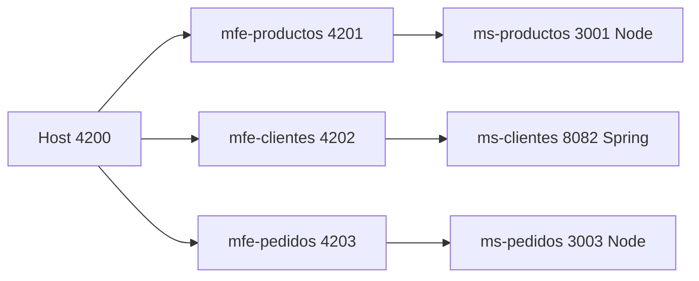

# Parcial II - Arquitectura de Software

Microfrontends (Angular + federation) integrados por un host, cada uno conectado a su propio microservicio (Node.js / Spring Boot). Todos aplican Clean Architecture.

Integrantes: Valentina Gonzalez Mejia y Juan Fernando Vargas.

## Arquitectura



## Qué microservicio consume cada microfrontend

| Microfrontend | Puerto | Microservicio | Tecnología | Puerto | URL consumida |
|---|---|---|---|---|---|
| mfe-productos | 4201 | ms-productos | Node.js | 3001 | http://localhost:3001/api/productos |
| mfe-clientes | 4202 | ms-clientes | Spring Boot | 8082 | http://localhost:8082/api/clientes |
| mfe-pedidos | 4203 | ms-pedidos | Node.js | 3003 | http://localhost:3003/api/pedidos |

El host (puerto 4200) carga los tres microfrontends con un navbar de navegación.

## Puertos

| Componente | Puerto |
|---|---|
| host | 4200 |
| mfe-productos | 4201 |
| mfe-clientes | 4202 |
| mfe-pedidos | 4203 |
| ms-productos | 3001 |
| ms-clientes | 8082 |
| ms-pedidos | 3003 |

## Requisitos

Node.js 20, JDK 17, Maven, Angular CLI 17 y Google Chrome.

## Ejecución (una terminal por componente, en este orden)

```bash
cd backend/ms-productos && npm install && npm start
cd backend/ms-clientes && mvn spring-boot:run
cd backend/ms-pedidos && npm install && npm start
cd frontend/mfe-productos && npm install && npm start
cd frontend/mfe-clientes && npm install && npm start
cd frontend/mfe-pedidos && npm install && npm start
cd frontend/host && npm install && npm start
```

Luego abrir http://localhost:4200

## Swagger

- ms-productos: http://localhost:3001/api-docs
- ms-clientes: http://localhost:8082/swagger-ui.html
- ms-pedidos: http://localhost:3003/api-docs

## Pruebas de los microfrontends

```bash
cd frontend/mfe-productos && ng test --no-watch --code-coverage --browsers=ChromeHeadless
```

(igual en mfe-clientes y mfe-pedidos; cobertura superior al 90%)

## Verificación rápida

```bash
bash scripts/verificar.sh
```

## Estándar de commits

Conventional Commits: `feat`, `fix`, `docs`, `test`, `chore`.
